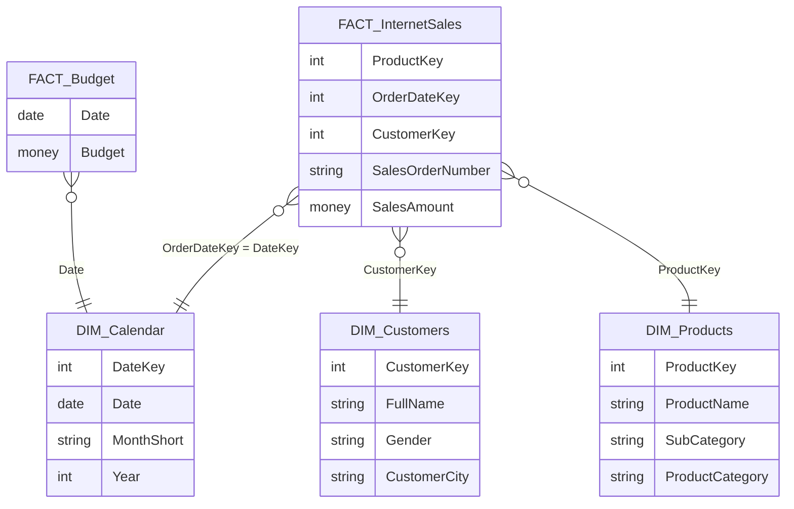
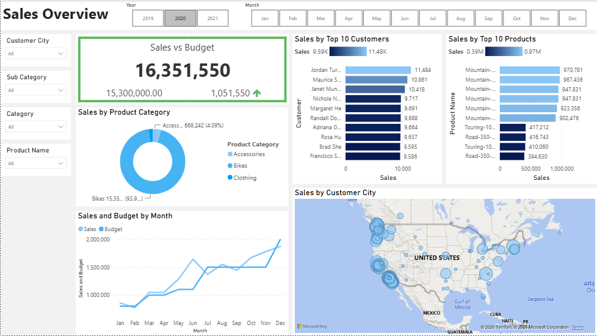
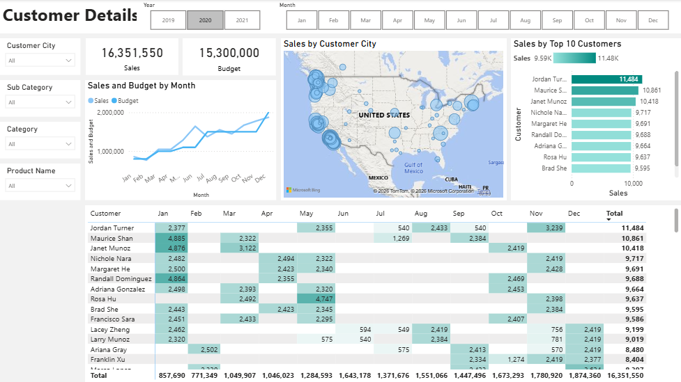
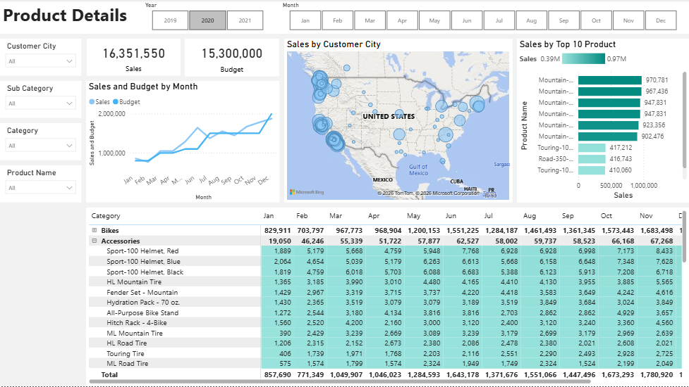
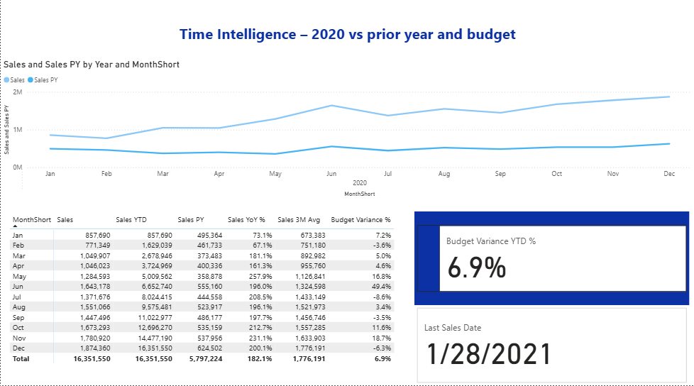
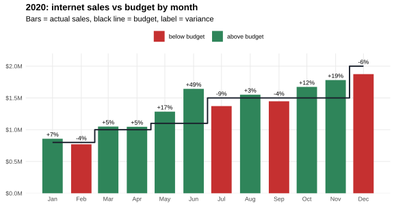
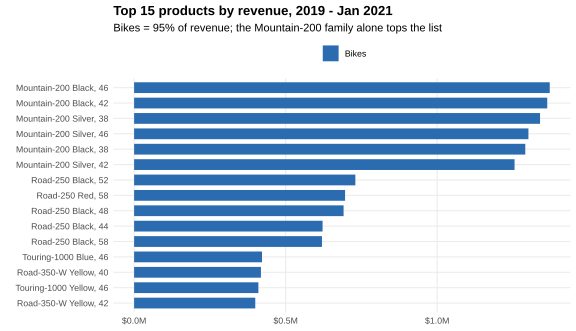
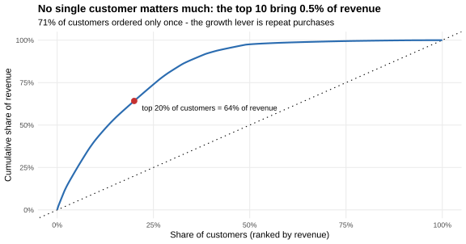

# Sales management dashboard in Power BI: from user stories to KPIs

**This end-to-end BI project starts from a sales manager's requirements. Raw AdventureWorks data is cleaned in SQL and modelled as a star schema, then turned into a three-page Power BI report that compares sales against budget. I extended it with DAX time-intelligence measures, a data-quality review, and a numerical answer to each user story.**


> **About this project.** The core (SQL cleaning, data model and the three report pages) follows Ali Ahmad's well-known guided *Power BI end-to-end sales management* tutorial. **My own work:**
> 1. the DAX time-intelligence measures ([`dax/`](dax));
> 2. a data-quality review that found six issues in the tutorial pipeline;
> 3. an independent analysis in R that answers each user story with numbers and gives a reference value for every DAX measure ([`analysis/`](analysis)).

## Business demand

The sales manager asks for better internet-sales reporting in place of static reports. The budget was delivered in Excel.

| # | As a | I want | So that | Acceptance criteria |
|---|---|---|---|---|
| 1 | Sales manager | A dashboard overview of internet sales | I can see which customers and products sell best | Power BI dashboard, data refreshed daily |
| 2 | Sales representative | A detailed view of internet sales per customer | I can follow up the customers who buy the most and find who to sell more to | Dashboard with a filter for each customer |
| 3 | Sales representative | A detailed view of internet sales per product | I can follow up the products that sell best | Dashboard with a filter for each product |
| 4 | Sales manager | Internet sales over time against budget | I can follow performance during the year | Graphs and KPIs comparing sales with budget |

## Data model

The data is cleaned with T-SQL from the AdventureWorksDW data warehouse ([`SQLCommands/`](SQLCommands)) and loaded into Power BI as a star schema:



**SQL cleaning:**
- Only the columns the report needs are selected.
- Customer and product tables are joined in for city, subcategory and category.
- First and last name are combined into a full name, and gender codes are decoded.
- A missing product status is set to "Outdated".

**Data:** 58,168 order lines, 25,429 orders and 18,222 customers, from January 2019 to January 2021. The budget covers January 2020 to June 2021.

## The report (`FinalProject/SalesReport.pbix`)

| Page | Visuals | Answers story |
|---|---|---|
| **Sales Overview** | Sales vs budget KPI, monthly sales and budget line chart, top products, top customers, sales by category (donut), sales map by city | 1, 4 |
| **Customer Details** | Sales and budget cards, monthly trend, map, customer × month matrix, top customers | 2 |
| **Product Details** | Sales and budget cards, monthly trend, map, category / product × month matrix, top products | 3 |
| **Time Intelligence** *(my extension)* | YTD, previous year, YoY %, 3-month average and budget variance in a month matrix; sales vs previous year line chart; YTD variance and data-freshness cards | 4 |

All pages share six slicers: year, month, customer city, product category, subcategory and product name. Measures live in a dedicated *Analysis Metrics* table: `Sales`, `Budget`, and `Sales / Budget`.



<details>
<summary><b>Customer Details</b> and <b>Product Details</b> pages</summary>





</details>

`FinalProject/SalesProductsCustomers.pbix` is an alternative one-page version, with budget by category, customers by gender and KPI visuals.

## My extension: DAX time intelligence ([`dax/time_intelligence.dax`](dax/time_intelligence.dax))

A fourth report page, **Time Intelligence**, uses these measures:



| Measure | DAX pattern | Business question |
|---|---|---|
| `Sales YTD`, `Budget YTD` | `TOTALYTD` on a marked date table | Where are we for the year so far? |
| `Budget Variance YTD %` | `DIVIDE` of the YTD measures | Are we ahead of or behind the annual plan? |
| `Sales PY`, `Sales YoY %` | `SAMEPERIODLASTYEAR` | Are we growing compared with last year? |
| `Budget Variance %` | `IF(NOT ISBLANK([Sales]), DIVIDE(...))` | Monthly variance, **blank where there is no data yet** instead of a false −100% |
| `Sales 3M Avg` | `DATESINPERIOD(..., -3, MONTH)` | What is the trend without month-to-month noise? |
| `Last Sales Date` | `CALCULATE(MAX(Date), FILTER(ALL(Calendar), ...))` | How fresh is the data shown on the KPI cards? |

**The measures were validated against an independent calculation.** For every month of 2020, R computes the value each measure should return ([`analysis/output/dax_reference_values_2020.csv`](analysis/output/dax_reference_values_2020.csv)).
- **70 of the 72 cells** in the Power BI matrix match exactly. For example, December 2020 shows `Sales YTD` 16,351,550, `Sales YoY %` 200.1% and `Budget Variance %` −6.3%, and the YTD budget variance card shows 6.9%.
- **The other 2 cells** are `Sales PY` and `YoY %` for February. They differ because of the source data, not the DAX: see issue 6 below.

## Findings: the user stories answered with numbers

*(`analysis/R/analysis.R`, same data as the report)*

### Story 4: sales against budget



- **2020 closed at 16.35M against a budget of 15.30M (+6.9%).** Sales beat the budget in 8 of 12 months.
- The best month was **June (+49%)**. The months below budget were February, July, September and December. December missed by −6.3% against the highest monthly target of the year (2.0M).
- Internet sales grew **2.8× from 2019 to 2020** (5.84M → 16.35M), so year-on-year growth is about +200% in most months.

### Stories 1 and 3: products



- **Bikes bring 95.3% of revenue.** Accessories bring 3.2% and clothing 1.5%.
- 117 products were sold. **29 of them make 80% of revenue.** The six Mountain-200 variants alone each sell between 1.26M and 1.37M.

### Stories 1 and 2: customers



- **No customer is critical.** The top 10 customers bring only 0.5% of revenue, and the top 20% bring 64%.
- **71% of customers ordered only once** (1.40 orders per customer on average). For the sales representatives, the lever is repeat purchases, not key-account management.
- The strongest cities are London (0.69M) and Paris (0.47M), followed by Wollongong, Bendigo (Australia) and Berlin.

## Data-quality review: six issues found in the pipeline

| # | Issue | Effect | Fix |
|---|---|---|---|
| 1 | **2 order lines have `OrderDateKey` 20190229**, a date that does not exist (2019 is not a leap year) | 2,854 of sales match no calendar row and disappear from every date-filtered visual | Correct the date in the source, or add a row-count check between the fact table and the calendar |
| 2 | **The budget runs to June 2021, but sales data ends on 28 January 2021** | Visuals of variance against budget show −100% for February-June 2021 | `Budget Variance %` returns blank when there are no sales |
| 3 | `ISNULL(p.Status, 'Outdated')` returns **"Outdate"** | `ISNULL` takes the type of its first argument. `Status` is `nvarchar(7)`, so the text is cut to 7 characters. | `COALESCE(p.Status, 'Outdated')` |
| 4 | **77 product names have more than one `ProductKey`** (price-history versions) | Totals by name are correct, but filters on key or item code split one product into several | Group by product name, or keep only the current version for product lists |
| 5 | The fact extract filters `OrderDateKey >= YEAR(GETDATE()) - 2` | Run today, it returns **no rows**, because the data ends in 2021 | Make the start year a Power Query parameter instead of using the server clock |
| 6 | **The Power BI model and the exported CSV disagree for February 2019**: 461,733 in the model against 504,140 in the CSV. All other months checked are equal. | The two copies of the "same" data were loaded separately and drifted apart. In the model, February 2020 year-on-year growth shows 67.1% instead of 53.0%. | Load the report from one source only, and add a reconciliation check of monthly totals against the source |

## Repository

```
├── BusinessDemands/     # business demand overview and user stories (.docx)
├── SQLCommands/         # T-SQL cleaning scripts for the 3 dimensions and the fact table
├── ArrangedData/        # exported tables (CSV) and the budget (Excel)
├── FinalProject/        # SalesReport.pbix (final report incl. Time Intelligence page), SalesProductsCustomers.pbix
├── dax/                 # time-intelligence measures (my extension)
├── screenshots/         # the four report pages
└── analysis/            # R validation and findings: R/, figures/, output/
```

To reproduce the analysis:

```bash
Rscript analysis/R/analysis.R    # needs data.table, readxl, ggplot2, svglite, scales
```

---

**Author:** Ivana Ercegovac · MSc Information Systems and Business Analytics
